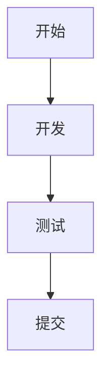

# 高阶秘法？

::: warning 警告
本节内容并不适合小白阅读
:::

---

> [!WARNING] 🚧 文档尚未完善
> 本文档已被标记为**需要完善**：本部分当中的内容需要相关同学参与完善，欢迎提交 PR 补充或修正文档内容。
> Wiki 不保证所有内容的真实性和时效性。

---

欢迎来到 **银川一中校园指南（YCYZ-Wiki）开发者文档**！

本文档面向参与 YCYZ-Wiki 开发、维护和内容建设的开发者，介绍项目的技术架构、开发环境配置、代码规范、内容编写方式及贡献流程。

无论是修改页面样式、开发 Vue 组件、完善 Wiki 内容，还是参与项目维护，都可以通过本文档了解相关流程。

## 一、项目介绍

### 1.1 关于 YCYZ-Wiki

银川一中校园指南（YCYZ-Wiki）是一个面向银川一中学生建设的校园综合信息门户与 Wiki 知识库。

项目以 Wiki 知识库为基础，逐步整合校园资讯、通知公告、校园生活指南等内容，为在校学生提供统一、便捷的信息入口。

项目希望成为：

- **校园信息入口**：集中整理校园相关信息。
    
- **校园知识库**：沉淀校园知识与实用经验。
    
- **校园记录平台**：记录校园活动与校园生活。
    
- **开放协作项目**：鼓励学生、校友及开发者参与建设。
    

### 1.2 项目仓库

|项目|地址|
|---|---|
|GitHub 仓库|[Fuchimio/YCYZ-Wiki](https://github.com/Fuchimio/YCYZ-Wiki)|
|Issues|[提交问题与建议](https://github.com/Fuchimio/YCYZ-Wiki/issues)|
|Pull Requests|[查看代码贡献](https://github.com/Fuchimio/YCYZ-Wiki/pulls)|

### 1.3 技术栈

|技术|用途|
|---|---|
|VitePress|静态站点生成、路由与 Markdown 内容管理|
|Vue 3|页面组件与交互功能|
|TypeScript|类型系统与代码维护|
|Vite|开发服务器与生产构建|
|pnpm|依赖管理|
|Git|版本控制与协作|

项目采用 VitePress + Vue 3 的技术架构，通过 Markdown 管理内容，通过 Vue 组件实现页面交互，并使用自定义主题构建校园门户与 Wiki 阅读体验。

## 二、开发环境配置

### 2.1 环境要求

开始开发前，请准备以下工具：

|工具|用途|
|---|---|
|Node.js|JavaScript 运行环境|
|pnpm|项目依赖管理|
|Git|版本控制|
|编辑器|推荐 Visual Studio Code|

建议使用受支持的 Node.js LTS 版本，并确保 pnpm 可以正常运行。

安装完成后，在终端执行：

```
node -v
pnpm -v
git --version
```

如果能够正常输出版本号，说明基础环境已经准备完成。

### 2.2 克隆仓库

在终端中执行：

```
git clone https://github.com/Fuchimio/YCYZ-Wiki.git
```

进入项目目录：

```
cd YCYZ-Wiki
```

如果已经克隆过仓库，可以直接进入本地项目目录。

### 2.3 安装依赖

在项目根目录执行：

```
pnpm install
```

pnpm 会根据 `package.json` 和 `pnpm-lock.yaml` 安装项目依赖。

首次安装可能需要一定时间，请等待安装完成。

### 2.4 启动开发服务器

执行：

```
pnpm run docs:dev
```

启动成功后，终端会显示本地访问地址，默认通常为：

```
http://localhost:5173/
```

在浏览器中打开该地址，即可查看本地开发版本。

开发服务器支持热更新。修改 Markdown、Vue 组件或样式后，通常可以在浏览器中直接看到变化。

### 2.5 生产构建

执行：

```
pnpm run docs:build
```

VitePress 会将站点构建为静态文件。

### 2.6 本地预览

构建完成后，执行：

```
pnpm run docs:preview
```

通过预览服务器检查生产构建结果。

### 2.7 常用命令

|命令|说明|
|---|---|
|`pnpm install`|安装项目依赖|
|`pnpm run docs:dev`|启动开发服务器|
|`pnpm run docs:build`|构建生产版本|
|`pnpm run docs:preview`|预览生产构建结果|

以上命令对应当前仓库 `package.json` 中的脚本配置。如果后续修改脚本名称，应同步更新本文档。

## 三、项目架构与目录结构

### 3.1 整体架构

YCYZ-Wiki 使用 VitePress 作为站点基础。

其主要组成部分如下：

- **内容层**：使用 Markdown 编写 Wiki、资讯和其他页面。
    
- **主题层**：使用 Vue 3 开发页面布局与交互组件。
    
- **配置层**：通过 VitePress 配置文件管理站点设置。
    
- **构建层**：由 VitePress 和 Vite 完成开发、静态生成与构建。
    

VitePress 负责 Markdown 解析、路由生成和静态站点构建；Vue 负责主题界面与组件交互。

### 3.2 当前目录结构

当前仓库的主要目录如下：

```
YCYZ-Wiki/
├── .vitepress/
│   ├── config.mts             # VitePress 站点配置
│   └── theme/                 # 自定义主题
│
├── docs/                      # Markdown 内容目录
│   ├── public/                # 静态资源
│   └── index.md               # 站点首页
│
├── .gitignore
├── LICENSE
├── README.md
├── package.json
└── pnpm-lock.yaml
```

以上是当前仓库的基础结构。随着功能开发，主题目录和内容目录可能进一步扩展。

### 3.3 VitePress 配置

`.vitepress/config.mts` 是 VitePress 的主要配置文件。

站点标题、描述、基础路径、Markdown 扩展、导航栏和侧边栏等配置均可在此管理。

修改配置前，建议先阅读 VitePress 官方文档：

[VitePress 配置参考](https://vitepress.dev/reference/site-config)

### 3.4 自定义主题

项目使用 VitePress 自定义主题机制。

主题主要由 Vue 组件和 CSS 样式构成。开发过程中应尽量将不同职责的界面拆分为独立组件，例如：

- Header：网站顶部导航。
    
- Footer：网站底部信息。
    
- HomePage：门户首页。
    
- WikiLayout：Wiki 文章布局。
    
- Sidebar：侧边分类导航。
    
- TableOfContents：文章目录。
    
- ThemeToggle：明暗主题切换。
    

以上是组件职责划分建议，具体文件名和目录以实际实现为准。

VitePress 自定义主题文档：

[Using a Custom Theme](https://vitepress.dev/guide/custom-theme)

### 3.5 内容与主题的关系

Markdown 内容和 Vue 主题相互配合：

- Markdown 负责文章结构和正文内容。
    
- Vue 组件负责可复用的交互和展示。
    
- CSS 负责视觉样式和响应式布局。
    
- VitePress 负责将内容和主题整合为静态页面。
    

不应为了实现普通文章排版而在每篇 Markdown 中重复编写大量 HTML 和 CSS。重复使用的展示结构应优先考虑封装为 Vue 组件。

## 四、技术开发规范

本节用于约定项目代码的组织方式和开发要求。

### 4.1 基本原则

开发过程中应遵循以下原则：

1. 保持代码结构清晰，避免不必要的复杂设计。
    
2. 优先复用已有组件和工具函数。
    
3. 不为简单功能引入不必要的依赖。
    
4. 保持页面布局、组件行为和视觉风格一致。
    
5. 新增功能应考虑移动端适配。
    
6. 修改已有功能时，尽量控制变更范围。
    
7. 不应提交与本次开发无关的文件。
    

### 4.2 TypeScript 规范

项目使用 TypeScript 编写主题逻辑和工具代码。

推荐：

- 为组件 Props 定义明确的类型。
    
- 为函数参数和返回值提供必要的类型。
    
- 优先使用已有类型，避免重复定义。
    
- 尽量避免使用 `any`。
    
- 对可能为空的数据进行明确判断。
    
- 避免使用不安全的类型断言绕过检查。
    

示例：

```
interface CardProps {
  title: string
  description: string
  link: string
}

function getCardTitle(card: CardProps): string {
  return card.title
}
```

### 4.3 Vue 组件规范

项目使用 Vue 3。

新增组件时建议：

- 使用 Composition API。
    
- 优先采用 `<script setup lang="ts">`。
    
- 使用 Props 传递组件数据。
    
- 保持组件职责单一。
    
- 将重复的展示逻辑封装为可复用组件。
    
- 避免将过多业务逻辑堆积在单个组件中。
    

示例：

```
<script setup lang="ts">
defineProps<{
  title: string
  description: string
}>()
</script>

<template>
  <article class="info-card">
    <h3>{{ title }}</h3>
    <p>{{ description }}</p>
  </article>
</template>
```

### 4.4 CSS 与样式规范

项目应建立统一的设计系统，避免不同页面出现不一致的视觉效果。

建议：

- 使用 CSS Variables 管理颜色、间距、圆角和阴影。
    
- 使用语义化的类名。
    
- 避免大量重复 CSS。
    
- 避免无必要的全局样式污染。
    
- 兼顾明暗主题。
    
- 使用媒体查询实现响应式布局。
    
- 优先使用项目已有的设计变量。
    

推荐命名：

```
.info-card {}
.info-card__title {}
.info-card__description {}
.info-card--featured {}
```

### 4.5 SSR 与静态生成兼容性

VitePress 使用服务端渲染和静态生成机制。

开发 Vue 组件时，应注意：

- 不要在模块顶层直接访问 `window`、`document` 等浏览器对象。
    
- 需要浏览器环境的代码，应在客户端生命周期中执行。
    
- 使用浏览器 API 前，应确认代码运行环境。
    
- 避免依赖只在浏览器中存在的全局对象进行服务端渲染。
    
- 新增交互组件后，应进行生产构建验证。
    

### 4.6 性能要求

开发过程中应关注：

- 图片大小和格式。
    
- 不必要的 JavaScript 依赖。
    
- 组件数量与渲染复杂度。
    
- 页面首屏加载速度。
    
- 静态资源加载策略。
    
- 移动设备上的使用体验。
    

不应为了简单的展示效果引入体积过大的依赖。

## 五、Markdown 内容编写规范

### 5.1 基本格式

项目主要使用 Markdown 编写页面内容。

推荐使用：

- 标题：`#`
    
- 段落：普通文本
    
- 列表：`-`
    
- 有序列表：`1.`
    
- 引用：`>`
    
- 代码块：三个反引号
    
- 表格：标准 Markdown 表格
    

每篇文章应有清晰的标题层级，不应随意跳级。

### 5.2 Frontmatter

VitePress 支持通过 YAML Frontmatter 设置页面元信息。

示例：

```
---
title: 校园生活指南
description: 介绍校园生活相关信息。
---
```

新增 Frontmatter 字段时，应考虑字段是否具有实际用途，并保持命名一致。

如果项目后续建立统一内容 Schema，应以该 Schema 为准。

### 5.3 图片与静态资源

静态资源统一放在内容目录下的 `public/` 中。

例如：

```
docs/
├── public/
│   ├── images/
│   ├── icons/
│   └── files/
└── index.md
```

在 Markdown 中引用：

```

```

图片使用时应注意：

- 尽量压缩图片。
    
- 使用具有描述性的文件名。
    
- 避免上传无关的大尺寸图片。
    
- 注意图片版权和肖像权。
    
- 不公开未经允许的个人信息。
    

### 5.4 Vue 组件

VitePress 支持在 Markdown 中使用 Vue 组件。

对于重复使用的卡片、提示框、时间线和图集等内容，可以考虑封装为 Vue 组件。

示例：

```
<InfoCard
  title="校园生活"
  description="了解校园生活相关信息"
  link="/wiki/life/"
/>
```

实际可用的组件名称、属性和使用方式，应以项目中已经注册的组件为准。

### 5.5 数学公式

如果项目配置了数学公式插件，可以使用 LaTeX 语法编写公式。

行内公式：

```
$E=mc^2$
```

块级公式：

```
$$
\int_{-\infty}^{+\infty}e^{-x^2}dx=\sqrt{\pi}
$$
```

注意：数学公式功能需要对应插件和配置支持，不应默认认为所有 Markdown 环境都已启用。

### 5.6 Mermaid 图表

如果项目集成 Mermaid，可以使用以下语法：

````

````

Mermaid 需要额外集成和配置。新增图表后，应验证开发环境和生产构建中的显示效果。

### 5.7 内容质量要求

校园指南中的内容应遵循：

- 准确、客观，尽可能提供可靠来源。
    
- 区分学校官方信息、经验分享和个人观点。
    
- 涉及时间敏感的信息，应注明更新时间。
    
- 不得将未经核实的信息描述为学校正式规定。
    
- 不得公开未经允许的个人隐私。
    
- 涉及校规、政策和重要通知时，应优先引用学校官方来源。
    

## 六、Git 工作流与代码贡献

### 6.1 获取最新代码

开始开发前，建议先同步主分支：

```
git switch main
git pull origin main
```

### 6.2 创建开发分支

不要直接在主分支上进行较大规模的功能开发。

建议按照修改类型命名分支：

|分支前缀|用途|
|---|---|
|`feat/`|新功能|
|`fix/`|问题修复|
|`docs/`|文档修改|
|`style/`|样式调整|
|`refactor/`|代码重构|

示例：

```
git switch -c feat/homepage
```

### 6.3 提交修改

完成修改后，先查看文件状态：

```
git status
```

检查具体改动：

```
git diff
```

确认无误后添加文件：

```
git add .
```

提交修改：

```
git commit -m "feat: add homepage layout"
```

### 6.4 Commit Message 规范

建议使用 Conventional Commits 风格：

```
<type>: <description>
```

常用类型：

|类型|说明|
|---|---|
|`feat`|新功能|
|`fix`|修复问题|
|`docs`|文档修改|
|`style`|样式调整|
|`refactor`|代码重构|
|`perf`|性能优化|
|`chore`|工程配置或维护|
|`test`|测试相关|

示例：

```
feat: add wiki sidebar
fix: resolve mobile navigation issue
docs: update developer documentation
style: improve homepage spacing
refactor: simplify theme components
```

### 6.5 推送代码

```
git push -u origin feat/homepage
```

如果你是通过 Fork 参与项目，请将 `origin` 指向自己的 Fork 仓库。

### 6.6 Pull Request

提交 Pull Request 前，请确认：

- 修改目标明确。
    
- 没有包含无关文件。
    
- 代码和文档符合项目规范。
    
- 页面在本地运行正常。
    
- 生产构建能够成功。
    
- 已说明修改内容和必要的测试结果。
    

Pull Request 应尽量围绕单一目标，方便维护者审查。

## 七、测试与提交前检查

### 7.1 基础检查

每次开发完成后，建议至少执行：

```
pnpm run docs:build
```

确保生产构建没有错误。

如果修改了页面布局、交互或主题样式，还应启动开发服务器进行浏览器检查。

### 7.2 检查清单

提交前建议逐项检查：

- 修改内容符合本次开发目标。
    
- 没有误提交缓存和构建产物。
    
- 没有提交个人环境配置或敏感信息。
    
- 页面布局正常。
    
- 移动端显示正常。
    
- 图片和链接可以正常访问。
    
- 新增组件没有明显的 SSR 问题。
    
- 生产构建成功。
    
- Commit Message 符合规范。
    

## 八、常见问题排查

### 8.1 pnpm 命令无法运行

检查 Node.js 和 pnpm 是否安装：

```
node -v
pnpm -v
```

如果 pnpm 不存在，请先完成 pnpm 安装和环境变量配置。

### 8.2 依赖安装失败

可以依次检查：

1. 网络连接是否正常。
    
2. Node.js 和 pnpm 版本是否符合要求。
    
3. `package.json` 是否存在错误。
    
4. `pnpm-lock.yaml` 是否与依赖配置一致。
    

不要在没有确认原因时直接删除锁文件。

### 8.3 开发服务器无法启动

尝试：

```
pnpm install
pnpm run docs:dev
```

如果仍然失败，请检查终端完整报错，尤其是依赖解析、配置文件和端口占用相关信息。

### 8.4 生产构建失败

执行：

```
pnpm run docs:build
```

根据错误信息定位问题。

常见原因包括：

- Markdown 语法错误。
    
- Vue 组件导入路径错误。
    
- TypeScript 类型错误。
    
- 浏览器 API 在服务端被调用。
    
- 配置文件语法错误。
    
- 插件与当前 VitePress 版本不兼容。
    

### 8.5 页面修改后没有生效

可以尝试：

- 确认修改的是正确文件。
    
- 检查浏览器是否刷新。
    
- 检查开发服务器终端是否有报错。
    
- 检查组件是否正确导入和注册。
    
- 必要时重新启动开发服务器。
    

## 九、项目贡献与协作

### 9.1 如何参与

欢迎通过以下方式参与 YCYZ-Wiki：

- 提交 Issue，报告问题或提出建议。
    
- 提交 Pull Request，改进代码和文档。
    
- 补充校园 Wiki 内容。
    
- 修正错误信息。
    
- 改进页面样式和交互体验。
    

### 9.2 Issue 规范

提交 Issue 时，建议说明：

- 问题或建议的标题。
    
- 问题发生的页面或功能。
    
- 复现步骤（如果是 Bug）。
    
- 预期结果和实际结果。
    
- 必要的截图或报错信息。
    

### 9.3 贡献原则

所有贡献都应遵循以下原则：

1. 尊重项目现有架构。
    
2. 不随意引入不必要的依赖。
    
3. 不提交未经许可的素材。
    
4. 不泄露个人隐私或敏感信息。
    
5. 保持代码和文档同步。
    
6. 对提交的修改负责，并完成必要验证。
    

## 十、参考资料

开发过程中可以参考以下官方文档：

|文档|地址|
|---|---|
|VitePress 官方文档|[https://vitepress.dev/](https://vitepress.dev/)|
|VitePress 配置参考|[https://vitepress.dev/reference/site-config](https://vitepress.dev/reference/site-config)|
|VitePress Markdown 扩展|[https://vitepress.dev/guide/markdown](https://vitepress.dev/guide/markdown)|
|VitePress 自定义主题|[https://vitepress.dev/guide/custom-theme](https://vitepress.dev/guide/custom-theme)|
|Vue 3 官方文档|[https://vuejs.org/](https://vuejs.org/)|
|TypeScript 官方文档|[https://www.typescriptlang.org/docs/](https://www.typescriptlang.org/docs/)|
|Vite 官方文档|[https://vite.dev/](https://vite.dev/)|
|pnpm 官方文档|[https://pnpm.io/](https://pnpm.io/)|
|Git 官方文档|[https://git-scm.com/doc](https://git-scm.com/doc)|

## 十一、文档维护

本文档是 YCYZ-Wiki 项目的开发规范与操作指南。

当项目目录、技术架构、依赖版本、开发命令或协作流程发生变化时，应及时更新本文档。

如果发现文档内容有误、过时或缺失，欢迎提交 Issue 或 Pull Request。

---

**YCYZ-Wiki · 养正人的校园指南针**